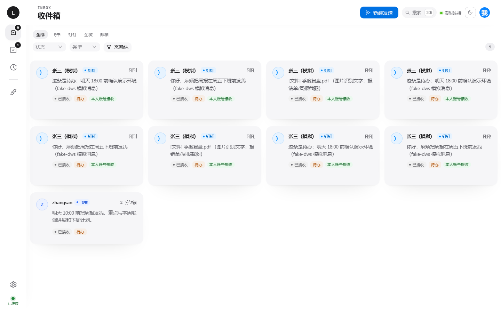
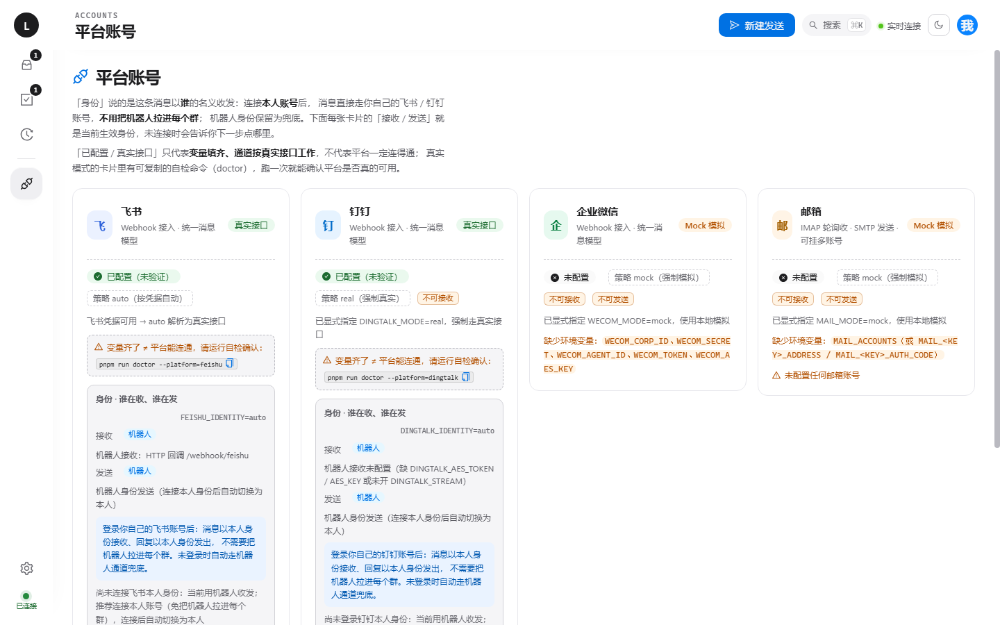
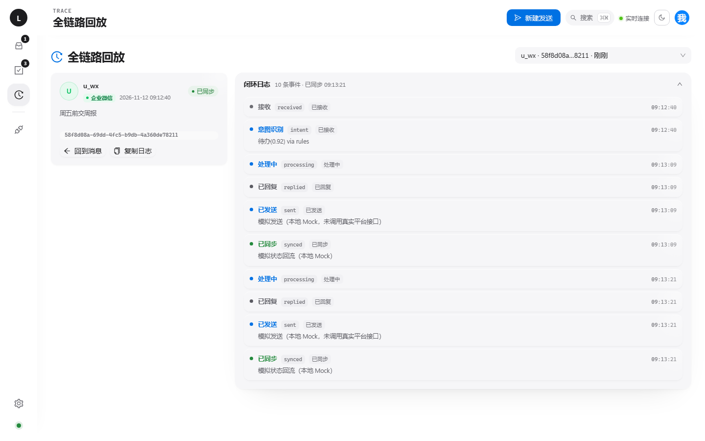

<div align="center">

# LinkHub

**飞书 · 钉钉 · 微信 · 邮箱 —— 四个平台，一个收件箱。**

收得到、回得去、说得清：统一接收 → 直接处理 → 真实回写 → 状态回流，全链路可回放。

`零账号可演示`　`换账号零代码`　`Mock 绝不假成功`

</div>

<p align="center">
  <a href="docs/images/inbox.png"></a>
  <a href="docs/images/accounts.png"></a>
  <a href="docs/images/trace.png"></a>
</p>

<p align="center"><sub>统一收件箱：四平台混排，标清「本人 / 机器人 / 模拟」　·　平台账号：真实还是模拟，一眼可知　·　全链路回放：按 traceId 看完整闭环（点击看大图）</sub></p>

## 这是什么

LinkHub（赛题 A 参赛作品）把飞书、钉钉、微信、邮箱的消息与待办收拢到一个入口：在同一个界面里阅读、回复、转待办、指定平台发送（含附件），并把每一步都记进闭环日志。

- **换账号零代码**：每个平台一段 `unimsg-connector/.env`，改凭据即换账号，四平台互不影响。
- **零账号能跑通**：不填任何凭据也能走完「接收 → 处理 → 回写 → 回流」，每一步都如实标注「模拟发送」，绝不假成功。
- **本人账号收发**：飞书用 OAuth、钉钉用官方 CLI `dws`，以员工本人身份收发，不用把机器人逐个拉进群。

## 30 秒跑起来

**Windows：** 双击仓库根目录的 `start.bat` —— 自动装依赖、起前后端并打开浏览器（约 1 分钟，无需预装 pnpm）。

**命令行（需 Node.js ≥ 20，pnpm 可用 corepack 提供）：**

```bash
cd unimsg-connector
corepack enable && pnpm install       # 已装 pnpm 可跳过 corepack

pnpm --filter @unimsg/server start    # 后端 :3001
pnpm --filter @unimsg/web dev         # 另开终端，前端 :5173
```

不配任何凭据也能体验完整闭环（全平台 Mock）。想一键验证链路：`pnpm e2e`（需要 Python 3）。

## 能做什么

| 环节 | 能力 |
|---|---|
| **接收** | 飞书长连接 / HTTP 回调、钉钉 Stream / HTTP 回调、微信 RPA 本地桥轮询、邮箱 IMAP 轮询；本人身份另走飞书 OAuth 轮询、钉钉 `dws` 个人事件 |
| **展示** | 收件箱按平台 / 状态筛选，WebSocket 实时推送；「本人 / 机器人 / 模拟」来源如实标注 |
| **下载** | 收到的图片 / 文件可直接下载：钉钉本人文件走 `fileId`（`dws drive download`）、飞书走 `file_key`（本人或机器人 token）；微信 RPA 附件经桥的 `GET /file` 回吐（只允许微信文件目录/桥 outbox）、邮件附件需到邮箱客户端查看 |
| **处理** | 直接回复、标记完成、手动加待办；AI 做意图识别 / 摘要 / 回复草稿（真实调用大模型，失败才回退规则并标注） |
| **回写** | 按平台格式异步发送文本与附件，`delivery` 记录真实通道与身份；失败可见原因并可重试 |
| **回流** | 平台状态事件回写本地状态机（`received → processing → replied → sent → synced`），异常进死信队列 |

## 平台支持

| 平台 | 收消息方式 | 真实接入状态 |
|---|---|---|
| 飞书 | 长连接 / HTTP 回调；本人 OAuth 轮询 | ✅ 机器人 + 本人身份均真实端到端通过（2026-11-12） |
| 钉钉 | Stream 长连接 / HTTP 回调；本人 `dws` 个人事件 | ✅ 机器人 Stream 真实收发通过；🟡 本人身份待企业开 CLI 访问 + 真人授权 |
| 微信 | RPA 本地桥（免公网，需本机微信桌面端） | 🟡 桥与连接器就绪；默认模拟演示。`WECHAT_MODE=real` 且桥就绪后：3.9.x 自动轮询接收，4.x 用「按需拉取」（拖选复制当前会话） |
| 邮箱 | 本机 IMAP 轮询（任意数量 / 任意服务商） | ✅ 四跳闭环（发 → 收 → 回 → 收）真实通过 |

> 未配置或凭据不全的平台自动回退本地 Mock，界面与接口都会标注「模拟」；`real` 模式缺凭据时**发送直接报错**，不会静默假成功。

## 换账号，只要 3 步

```bash
cd unimsg-connector
cp .env.example .env          # Windows：Copy-Item .env.example .env
# 2) 只填目标平台那一段，其余留空（留空 = auto 自动回退 Mock）
pnpm run doctor               # 3) 只读自检：凭据 / 连通性 / 出口 IP / 修复建议
```

各平台最少要填的变量：

| 平台 | 最少变量 |
|---|---|
| 飞书 | `FEISHU_APP_ID` / `FEISHU_APP_SECRET`（HTTP 回调另需 `FEISHU_VERIFY_TOKEN`；长连接设 `FEISHU_STREAM=true`） |
| 钉钉 | `DINGTALK_CLIENT_ID` / `DINGTALK_CLIENT_SECRET` / `DINGTALK_ROBOT_CODE` / `DINGTALK_STREAM=true` |
| 微信 | `WECHAT_MODE=real` + `WECHAT_BRIDGE_URL`（默认 `http://127.0.0.1:8787`，通常无需改）；另需本机启动 RPA 桥并登录微信桌面端（3.9.x 可自动收；4.x 用「按需拉取」） |
| 邮箱 | `MAIL_<KEY>_ADDRESS` / `MAIL_<KEY>_AUTH_CODE`（授权码，不是登录密码） |

> 单平台自检：`pnpm run doctor --platform=feishu|dingtalk|wechat|mail`。
> 注意必须写 `pnpm run doctor`：`pnpm doctor` 会被 pnpm 内置同名命令抢占，**没有任何输出、退出码 0**，看起来像成功。
> 逐平台后台操作、errcode 排错与邮箱服务商预设见 [docs/swap-accounts.md](docs/swap-accounts.md)。

## 常用命令

在 `unimsg-connector/` 下执行：

| 命令 | 作用 |
|---|---|
| `pnpm start` / `pnpm dev` | 启动后端（`dev` 为 watch 模式） |
| `pnpm --filter @unimsg/web dev` | 启动前端（:5173） |
| `pnpm run doctor` | 只读自检；有 FAIL 时退出码 1 |
| `pnpm test` / `pnpm test:web` | 服务端 / 前端单元测试 |
| `pnpm typecheck` | shared + server + web 三个包的 TypeScript 检查 |
| `pnpm e2e` / `pnpm e2e:sh` | 一键端到端冒烟（Windows / macOS · Linux） |
| `pnpm run deliver` | 交付打包（自动排除 `.env`、日志、`node_modules`） |
| `docker compose up -d --build` | 单容器部署，同源访问 `http://<IP>:3001` |

Windows 根目录脚本：

| 命令 | 作用 |
|---|---|
| `start.bat` / `start-docker.bat` | 一键启动（本地 / Docker） |
| `start.bat mock` / `start.bat doctor` / `start.bat accounts` | 纯离线演示 / 账号自检 / 编辑账号配置 |
| `start.bat restart` / `start.bat ports` / `start.bat stop` | 安全重启（只停 LinkHub 自己的进程）/ 查看端口占用 / 停止服务 |

## 当前状态

- **测试**：`typecheck` 通过；附件下载相关 server 用例 **43 项**全过（2026-11-19）；web 与全量 server 套件以当前工作区实际输出为准；`pnpm e2e` 20 项断言 PASS；契约自检 81 PASS。
- **持久化**：默认内存 + 可选文件快照（设 `DATA_DIR`）；PostgreSQL / Redis 仅有 DDL 与仓储接口，未实装。
- **OCR**：仍是占位实现（赛题 A 不依赖 OCR）。
- **大模型**：OpenAI 兼容协议真实调用（默认 MiMo `mimo-v2.6-flash`），失败回退规则并标注来源。

## 已知限制（诚实说明）

- **钉钉**群聊只推「@机器人」的消息——平台规则，不能承诺群内所有消息都能聚合。
- **微信**个人版无官方收发 API，走 RPA 通道：默认为模拟演示，真实收发需本机登录微信桌面端 + 启动本地 RPA 桥（`scripts/wechat-rpa/rpa_bridge.py`）并设置 `WECHAT_MODE=real`。**3.9.x** 可自动轮询接收；**4.x** 是 Qt 自绘界面、无控件树，改用「按需拉取」（收件箱 → 微信 → 从微信拉取当前会话，拖选复制原文）。受窗口布局/分辨率影响，有账号风控风险，仅作补充通道。
- **钉钉本人身份**依赖官方 `dws`（共创阶段）：需企业管理员开「CLI 访问管理」+ 首次真人授权；凭据绑定设备，不能跨机复制。
- **飞书本人接收是轮询**（默认 20s，通常 5–30s 延迟），只能读本人可见会话；权限需管理员开通并生效。
- 入口令牌默认 `dev-token`，仅本机演示用；对外暴露前必须改 `API_TOKEN`，并按需设 `CORS_ORIGINS` / `SERVER_HOST`。

完整风险清单见 [docs/risk-register.md](docs/risk-register.md)。

## 文档导航

| 我想…… | 看这里 |
|---|---|
| 5 分钟上手 / 常见卡点 | [docs/quickstart.md](docs/quickstart.md) |
| 零账号首次使用（白号：2 项可自助 + 2 项需管理员） | [docs/quickstart.md](docs/quickstart.md)（路径 E）· [docs/desktop-app.md](docs/desktop-app.md) |
| 换成自己的账号（逐平台 checklist） | [docs/swap-accounts.md](docs/swap-accounts.md) |
| 用本人账号收发（飞书 OAuth / 钉钉 dws） | [docs/personal-identity.md](docs/personal-identity.md) |
| 现场演示 / 录视频 | [docs/demo-script.md](docs/demo-script.md) |
| 交付打包 / 验收 | [docs/delivery-checklist.md](docs/delivery-checklist.md) |
| 独立服务器部署 | [docs/deploy.md](docs/deploy.md) |
| 桌面版（Electron / 轻量版） | [docs/desktop-app.md](docs/desktop-app.md) |
| AI 服务集成说明 | [docs/ai-integration.md](docs/ai-integration.md) |
| 完整技术参考：环境变量全表 / API 一览 / 测试记录 / 目录结构 | [docs/reference.md](docs/reference.md) |
| 赛题设计文档（初赛精简版 / 决赛完整版） | [documents/](documents/) |

## 技术栈

Node.js ≥ 20 · TypeScript · Express 4 + ws · React 18 + Vite 5 + Ant Design 5 · 内存仓储 + 可选文件快照 · OpenAI 兼容大模型 · 官方 `dws` CLI。

## License

见 [LICENSE](LICENSE)。