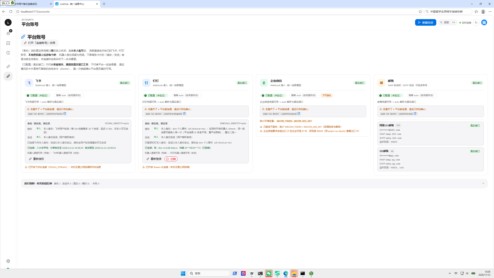
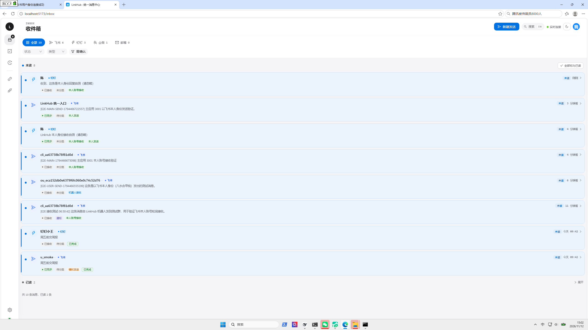

# 飞书本人身份收发 · 真实租户端到端验收记录（2026-11-12）

> **验收对象**：LinkHub 飞书「本人账号收 + 本人账号发」——真实 OAuth 授权 → 本人可见会话枚举 → 单聊 / 群聊轮询入库 → 以本人身份发送，并在飞书侧核对发送者身份。
>
> **结论：通过。** 本机租户此前记录的 `21001 Access denied due to platform policy` 在 2026-11-12 复测时已解除（`app_access_token` / `tenant_access_token` 均 `code:0`）。
>
> **文档分工**：平台边界与后台配置以 [docs/personal-identity.md](../personal-identity.md) 为准；本页只记录本次真实验收的环境、前置配置、证据、已知限制与复现步骤。

---

## 1. 结论先行

| 验收项 | 结果 | 关键证据 |
|---|---|---|
| 租户策略 `21001` | ✅ 本机租户已解除 | `POST /open-apis/auth/v3/app_access_token/internal`、`/tenant_access_token/internal` 均返回 `code:0`（2026-11-12 14:16，仓库 `.env` 真实凭据） |
| 真实 OAuth 授权 | ✅ 成功 | 授权账号「八水合甲烷」，`open_id=ou_eca152db0e6379f6fc060e0c74c52d76`，令牌落盘 `unimsg-connector/.data/feishu-user-token.json`（已 gitignore） |
| 本人会话枚举（单聊 + 群聊） | ✅ 成功 | 不带 `types`：2 个群聊；`types=p2p,group`：5 个会话（2 群 + 3 单聊）；`types=p2p`：只返回 3 个单聊 |
| 本人身份接收 | ✅ 成功 | 群聊与单聊消息均以 `receivedAs=user` 入库；日志 `[feishu-user] 本人账号收到消息：单聊「LinkHub」 · …` |
| 本人身份发送 | ✅ 成功 | `POST /api/messages/compose` → 202 / `status=replied` / `sendIdentity=user`；飞书侧核对 `sender.sender_type=user`、`is_agent=false` |
| 主应用（3001）收件箱 | ✅ 成功 | 机器人向本人 open_id 发一条单聊后，收件箱出现 `receivedAs=user` / `conversation.type=p2p` / `title=LinkHub` 的条目 |
| 独立测试实例（3101） | ✅ 成功 | 与主应用 3001 各自完整跑通一次「授权 → 收 → 发」 |

---

## 2. 环境与前置配置

### 2.1 验收环境

- 时间：2026-11-12 14:16 起（本机时区 `+08:00`）
- 仓库：`C:\Users\zx\Desktop\LinkHub`，HEAD 含提交 `f8d6e10`（本轮 `types` / `im:chat:read` 改动已进入 HEAD）
- 运行时：Windows 11、Node 24.14.0、pnpm 9.15.9（corepack）
- 后端实例：用户主应用 `3001`；独立测试实例 `3101`
- 凭据来源：仓库 `unimsg-connector/.env` 中的真实飞书 App 凭据（**App Secret 不写入本文**）
- 数据目录：`DATA_DIR=unimsg-connector/.data`；用户令牌文件 `unimsg-connector/.data/feishu-user-token.json`（已 gitignore，**不提交**）

### 2.2 飞书后台已完成的配置（实测有效）

应用：`LinkHub`（App ID `cli_aa63738b78f81d0d`，测试企业「LinkHub 测试」）。

| 配置项 | 值 / 状态 |
|---|---|
| 安全设置 → 重定向 URL | `http://localhost:3001/api/feishu/oauth/callback`（此前为空，会导致授权页报 `20029`） |
| 权限管理 → 用户身份权限 | `im:message`、`im:message.send_as_user`、`im:resource`、`im:message.p2p_msg:get_as_user`、`im:message.group_msg:get_as_user`、`im:chat:read`、`offline_access`（后台显示为「持续访问已授权的数据」） |
| 刷新 user_access_token | **未见独立开关**（新版控制台「安全设置」只有「重定向 URL」和「IP 白名单」两个页签）；实测 OAuth 授权返回 `refresh_token` 且 `refresh_token_expires_in` 有值 → `offline_access` 已生效，可自动续期 |
| 应用发布状态 | 应用当前为**测试应用**（后台横幅：「当前为测试应用，修改后无需重新审核即可生效，请在测试企业中使用真实业务数据」；左侧导航**没有**「版本管理与发布」入口）；本次后台改动（重定向 URL / 用户身份权限）实测即时生效，无需走发布审核 |

> **适用范围提醒**：本次验收是**测试企业「LinkHub 测试」里的自建测试应用**，因此「本机租户 `21001` 已解除」「权限即时生效」等结论**只对本租户 / 本测试应用成立**；正式比赛 / 正式企业环境仍需按各租户实际情况重新验证（`21001` 仍是平台策略，见 E1）。

两个实测坑（均已修复）：

1. **重定向 URL 为空 → 授权页报 `20029 重定向 URL 有误`**：把上面的回调地址登记到后台后恢复。
2. **`offline_access` / `im:resource` 未开通 → 授权页报 `20027 当前应用权限不足`**：在「权限管理 → 用户身份权限」的「开通权限」抽屉里按用户身份权限勾选，点「确认开通权限」即可（测试应用免审、即时生效），随后重新授权。

### 2.3 授权账号与令牌

- 授权账号：飞书个人账号「八水合甲烷」
- `open_id`：`ou_eca152db0e6379f6fc060e0c74c52d76`（标识符，不是凭据）
- `tenant_key`：`198c47b5b04bdbad`
- 令牌：`access_token` 约 2 小时（`expires_in`），`refresh_token` 约 7 天（`refresh_token_expires_in` 已返回），到期自动 refresh
- 授权实际拿到的 scope（实测令牌 `scope` 字段）：

  ```text
  auth:user.id:read im:chat:read im:message im:message.group_msg:get_as_user im:message.p2p_msg:get_as_user im:message.send_as_user im:resource offline_access
  ```

  > `auth:user.id:read` 为飞书授权时附带返回；LinkHub 主动申请的是 `im:message`、`im:message.send_as_user`、`im:resource`、`im:message.p2p_msg:get_as_user`、`im:message.group_msg:get_as_user`、`im:chat:read`、`offline_access`。

- 令牌只存服务端令牌文件，本文 / 日志 / 前端均不出现令牌值。

---

## 3. 实测证据（7 条）

### E1 租户策略 `21001` 已解除

2026-11-12 14:16，用仓库 `.env` 里的真实凭据调用：

- `POST /open-apis/auth/v3/app_access_token/internal` → `code:0`
- `POST /open-apis/auth/v3/tenant_access_token/internal` → `code:0`

此前 README 记录为 `21001 Access denied due to platform policy`（2026-11-03 / 11-10）。说明**本机租户**的平台策略限制已解除（推测为完成企业认证 / 策略调整，未获官方证实）。

> **不要写成「21001 不存在了」**：`21001` 仍是飞书平台策略，换租户 / 换环境 / 平台策略变化都可能再现；README 与 [personal-identity.md §3.1](../personal-identity.md#31-飞书轮询用户可见范围租户策略) 保留历史排错说明。

### E2 真实 OAuth 授权成功

- `POST /api/feishu/oauth/start`（Bearer）返回真实飞书授权链接，浏览器用「八水合甲烷」完成授权。
- `GET /api/feishu/oauth/callback` 回调成功，令牌落盘 `unimsg-connector/.data/feishu-user-token.json`（已 gitignore）。
- 实测有效期：`expires_in` → access_token 约 **2 小时**；`refresh_token_expires_in` 已返回 → refresh_token 约 **7 天**。

### E3 列会话：不带 `types` 只有群聊，带 `types=p2p,group` 才出现单聊

用 user token 调用 `GET /open-apis/im/v1/chats`（`user_id_type=open_id`）：

| 请求 | 返回 |
|---|---|
| `?user_id_type=open_id&page_size=50`（**不带** `types`） | **2 个群聊**：`测试企业 - LinkHub 测试`、`LinkHub 测试群`；**没有单聊** |
| 同上 + `&types=p2p,group` | **5 个会话**：2 个群聊 + 3 个单聊（审批 / 云文档助手 / 账号安全中心） |
| 同上 + `&types=p2p` | 只返回那 3 个单聊 |

结论：官方文档写的「不包含单聊」是**默认行为**；加未公开参数 `types` 才能列到单聊。该参数未收录于公开 API 文档（飞书官方 CLI 在用），存在被平台调整的风险，代码已做降级兜底（见 §5）。

### E4 轮询器把群聊与单聊都入库为 `receivedAs=user`

- 轮询器实测：群聊消息与**单聊消息**都成功以 `receivedAs=user` 入库。
- 日志原文示例：

  ```text
  [feishu-user] 本人账号收到消息：单聊「LinkHub」 · 发送者=... · 类型=text
  ```

- 群聊消息走同一通道（日志标「群聊」）；水位按会话持久化到 `unimsg-connector/.data/feishu-user-receive.json`。

### E5 本人身份发送 + 飞书侧发送者核对

- 请求：`POST /api/messages/compose`，body：

  ```json
  {"platform":"feishu","conversationId":"oc_b336da164f5438e60111ba4d3f1db1ae","conversationType":"p2p","identity":"user","text":"<测试文本>"}
  ```

- LinkHub 返回：**202**、`status=replied`、`sendIdentity=user`。
- 随后用 user token 拉该会话最新消息核对：

  | 字段 | 实测值 |
  |---|---|
  | `sender.id` | `ou_eca152db0e6379f6fc060e0c74c52d76` |
  | `sender.id_type` | `open_id` |
  | **`sender.sender_type`** | **`user`** |
  | `sender.is_agent` | `false` |

  → 确认是**真人本人**发出，不是机器人。

### E6 主应用（3001）收件箱实测

- 机器人向本人 open_id 发送一条单聊消息，正文形如 `[E2E-MAIN-...] 主应用 3001 本人账号接收验证`。
- 用户主应用 3001 的收件箱出现该条目：`receivedAs=user`、`conversation.type=p2p`、`title=LinkHub`。
- 证明「别人（含机器人）发给我」的单聊消息能被本人身份轮询读到并入库。

### E7 两个实例各自验证一次

- 独立测试实例 3101：完整跑通「授权 → 收单聊 + 群聊 → 以本人身份发送」。
- 用户主应用 3001：完整跑通（含 E6 收件箱实测）。
- 两次均通过。

---

## 4. 覆盖率（本轮）

| 检查 | 结果 |
|---|---|
| `pnpm --filter @unimsg/server test` | ✅ **438 tests 全过**（exit 0；含本轮新增的 `types` 降级用例与「水位内消息不重复 ingest」用例，约 4s） |
| `pnpm --filter @unimsg/web test` | ✅ **28 文件 / 255 tests 全过**（exit 0） |
| `pnpm -r typecheck` | ✅ `shared` / `server` / `web` 三包全过（exit 0） |

本轮相关单测：

- `packages/server/src/connectors/feishuUserReceive.test.ts`：`fetchUserChats()` 默认 URL 带 `types=p2p%2Cgroup`；`types` 被拒（`232001`）后自动降级重试，且进程内记住降级状态（`feishuChatTypesEnabled() === false`）。
- `packages/server/src/config/runtime.test.ts`：本人接收开启时 scope 必须包含 `im:chat:read`；固定机器人 / 关闭本人接收时不申请。

---

## 5. 本轮代码改动（已随提交 `f8d6e10` 进入 HEAD）

1. `packages/server/src/config/runtime.ts`：`FEISHU_USER_RECEIVE_SCOPES` 新增 `'im:chat:read'`。缺它对 user token 调 `/im/v1/chats` 直接报 `99991679`（`required one of [im:chat:readonly, im:chat, im:chat.group_info:readonly, im:chat:read]`），一条会话都列不出来。
2. `packages/server/src/connectors/feishuUserReceive.ts`：
   - `fetchUserChats()` 默认带 `types=p2p,group`；
   - 平台若报参数错误（`232001` / invalid request parameter），**进程内永久降级**为不带 `types` 的纯群列表（降级后单聊收不到，但群聊继续可用，不阻断接收）；
   - 新增 `resetFeishuChatTypesProbe()` / `feishuChatTypesEnabled()`；返回值新增 `p2pIncluded` 字段。
3. 单测：`feishuUserReceive.test.ts` 新增「`types` 被拒自动降级」用例并断言 URL 带 `types`；`config/runtime.test.ts` 断言 `im:chat:read` 随本人接收开关一起申请。
4. `packages/server/src/stream/feishuUserPoller.ts`（验收时补的健壮性修复）：
   - 新增 `alreadySeen`：`create_time <= 水位` 的消息直接跳过、不再 ingest。此前每轮都会把水位同一秒的最后一条重新入库 → 每次触发 `redelivered` trace + **全量落盘**（长期运行会磁盘抖动、状态文件与 trace 无限增长）；修复后每轮日志为「…重复 0 条，已见过 N 条」。
   - 水位推进改为「本批处理过的最大 `create_time`」（含按规则跳过的自环 / 系统 / 未知类型消息），避免不可映射的最新消息导致该会话每轮被反复重拉。
   - 单测 `feishuUserPoller.test.ts` 新增「水位内的消息算已见过、不重复 ingest」用例（两轮验证第二轮零入库），server 用例数 437 → 438。

---

## 6. 已知限制（如实记录，勿淡化）

1. **接收仍是轮询**（默认 20s，实际 5–30s 延迟）；飞书官方**至今没有个人消息推送事件**（2026-11-12 复核：`im.message.receive_v1` 只推给机器人；用户身份可订阅的业务仅云文档 / 日历 / 邮箱）。
2. **`types=p2p,group` 是未公开参数**（官方 CLI 在用、公开文档未收录），有被平台调整的风险；已做降级兜底（见 §5）。
3. **单聊会话只能以本人身份列出**，机器人身份列不出（平台隐私限制）。
4. **本人可见范围**：只能读到本人所在会话与本人可见消息；本人的 open_id 拿不到时自环过滤会降级（已有告警）。
5. **双通道并存**（机器人长连接 `FEISHU_STREAM=true` + 本人轮询）：在「机器人与本人同处的单聊」里同一条消息可能被两条通道各入库一次；实测中该单聊里本人发出的消息先被机器人长连接入库为 `receivedAs=bot`（同一 `externalId` 幂等，只留一条）。**建议演示时二选一**。
6. **水位同一秒的消息每轮仍会被「拉回」一次（API 层不可避免），但不再重复 ingest**：飞书 `start_time` 只能精确到秒，所以水位同一秒的最后一条每轮都会被接口返回；LinkHub 已把 `create_time <= 水位` 的消息计为「已见过」直接跳过（`alreadySeen`），不再触发 `redelivered` trace 与全量落盘。实测日志形如「…新入库 1 条，重复 0 条，已见过 2 条」。若把 `FEISHU_USER_BACKFILL_HOURS` 调大做回溯，首轮仍会出现一批 `duplicates`（幂等丢弃，属正常）。
7. **令牌**：`access_token` 约 2h 自动 refresh（`offline_access` 已开）；`refresh_token` 约 7 天，过期需重新授权。

---

## 7. 复现步骤（含命令）

### 7.1 `.env` 前置（只写占位符，绝不写真实值）

```dotenv
FEISHU_APP_ID=<你的应用 App ID>
FEISHU_APP_SECRET=<你的应用 App Secret>
FEISHU_STREAM=false              # 避免双通道重复；要演示双通道另行说明
FEISHU_IDENTITY=auto
FEISHU_USER_RECEIVE=true         # 或 auto（身份解析为本人时自动开启）
FEISHU_USER_RECEIVE_SECONDS=20
FEISHU_USER_BACKFILL_HOURS=0     # 0 = 首轮只立基线，不灌历史
FEISHU_REDIRECT_URI=http://localhost:3001/api/feishu/oauth/callback
```

> 令牌由 OAuth 回调自动落盘，不需要手工复制；`unimsg-connector/.data/feishu-user-token.json` 已被 `.gitignore` 覆盖。

### 7.2 飞书后台（照 §2.2 与 [personal-identity.md §4.1](../personal-identity.md#41-后台一次性配置应用管理员--所有者操作)）

- 「权限管理 → 用户身份权限」开通 7 项（含 `im:chat:read`、`offline_access`），点「确认开通权限」；
- 「安全设置 → 重定向 URL」与 `FEISHU_REDIRECT_URI` 逐字符一致；
- 确认授权返回 `refresh_token` + `refresh_token_expires_in`（`offline_access` 生效、可自动续期）；**测试应用**改动免审即时生效、无需走发布审核（正式应用仍需发布版本并使权限生效）。

### 7.3 启动与授权（在 `unimsg-connector/` 下）

```bash
pnpm --filter @unimsg/server start     # 默认 3001；确认日志无 21001 / 权限错误
curl -X POST -H "Authorization: Bearer dev-token" http://127.0.0.1:3001/api/feishu/oauth/start
# 返回 { ok:true, data:{ url, redirectUri } }；浏览器打开 data.url，用要绑定的本人账号同意授权
curl -H "Authorization: Bearer dev-token" http://127.0.0.1:3001/api/accounts
# feishu.identity.user.state = linked；displayName = 授权账号名
```

PowerShell 等价写法：

```powershell
Invoke-RestMethod -Method Post -Headers @{Authorization='Bearer dev-token'} http://127.0.0.1:3001/api/feishu/oauth/start
```

### 7.4 列会话实证（不带 types = 2 群 vs 带 types = 5 会话）

```powershell
# 在仓库根目录执行：只从本地令牌文件读 token，不打印令牌
$tok = (Get-Content unimsg-connector/.data/feishu-user-token.json -Raw | ConvertFrom-Json).accessToken
$h = @{ Authorization = "Bearer $tok" }
$base = 'https://open.feishu.cn/open-apis/im/v1/chats?user_id_type=open_id&page_size=50'
$without = (Invoke-RestMethod -Headers $h $base).data.items
$with    = (Invoke-RestMethod -Headers $h ($base + '&types=p2p%2Cgroup')).data.items
$p2pOnly = (Invoke-RestMethod -Headers $h ($base + '&types=p2p')).data.items
"不带 types：$($without.Count) 个会话（本次实测 2，只有群聊）"
"types=p2p,group：$($with.Count) 个会话（本次实测 5 = 2 群 + 3 单聊）"
"types=p2p：$($p2pOnly.Count) 个单聊（本次实测 3）"
$with | Select-Object chat_id, name, chat_mode
```

> 令牌只在内存中使用、不打印；`chat_mode=p2p` 的行是单聊。

### 7.5 接收验证

1. 用另一个飞书账号给本人发一条**单聊**；再往本人所在的群里发一条群消息（本人身份只需可见，不必 @）。
2. 观察后端日志应出现：

   ```text
   [feishu-user] 本人账号收到消息：单聊「...」 · 发送者=... · 类型=text
   ```

   群聊消息标「群聊」。
3. 查询接口：

   ```bash
   curl -H "Authorization: Bearer dev-token" "http://127.0.0.1:3001/api/messages?platform=feishu"
   # 条目 receivedAs="user"；单聊 conversation.type="p2p"
   ```

4. 首轮默认只立基线，历史消息不入库；需要回溯时设 `FEISHU_USER_BACKFILL_HOURS=24` 后重启。

### 7.6 发送验证（本人身份）

```bash
curl -X POST http://127.0.0.1:3001/api/messages/compose \
  -H "Authorization: Bearer dev-token" -H "Content-Type: application/json" \
  -d '{"platform":"feishu","conversationId":"oc_xxx","conversationType":"p2p","identity":"user","text":"<测试文本>"}'
# 期望 202 + status="replied" + sendIdentity="user"；conversationId 用 §7.4 里某个单聊的 chat_id
```

随后用 user token 拉该会话最新消息，核对飞书侧发送者：

```powershell
$tok = (Get-Content unimsg-connector/.data/feishu-user-token.json -Raw | ConvertFrom-Json).accessToken
$h = @{ Authorization = "Bearer $tok" }
$chatId = 'oc_xxx'   # 换成实际单聊 chat_id
$r = Invoke-RestMethod -Headers $h "https://open.feishu.cn/open-apis/im/v1/messages?container_id_type=chat&container_id=$chatId&sort_type=ByCreateTimeDesc&page_size=1"
$m = $r.data.items[0]
"sender.sender_type=$($m.sender.sender_type) is_agent=$($m.sender.is_agent) sender.id=$($m.sender.id)"
# 期望 sender.sender_type=user、is_agent=false、sender.id=本人 open_id
```

### 7.7 主应用（3001）收件箱验证

- 让机器人（或同事）向本人 open_id 发一条单聊，收件箱应出现 `receivedAs=user`、`conversation.type=p2p` 的条目；本次实测标题为 `LinkHub`。

---

## 8. 证据截图（2026-11-12 实测，主应用 3001 + 前端 5173）

| 截图 | 说明 |
|---|---|
|  | 「平台账号」页：飞书卡片显示 **接收 本人 / 发送 本人**、已连接「八水合甲烷」、令牌有效至 2026/11/12 16:46；钉钉同为本人身份；企微/邮箱保持原通道 |
|  | 收件箱：单聊消息标注 **本人账号接收**（`receivedAs=user`），以本人身份发出的消息标注 **本人发送**（`sendIdentity=user`） |

> 截图只含账号展示名与消息正文，不含任何令牌 / App Secret / 邮箱授权码。

---

## 9. 敏感信息与文档纪律

- 本文**不含**任何 `access_token` / `refresh_token` / App Secret / 邮箱授权码；`open_id`、`tenant_key`、App ID 是标识符，不是凭据。
- 令牌文件 `unimsg-connector/.data/feishu-user-token.json` 已被 gitignore，**不提交、不截图、不发群**。
- 平台策略 / 权限名以后台当时展示为准；平台侧变化时以新的实测结果更新本文与 [docs/personal-identity.md](../personal-identity.md)。

---

## 10. 桌面版（LinkHub-Lite 分发包）补充验证（2026-11-12 晚）

**背景**：把桌面版分发给员工时，每台机器的本地服务端口可能不同，而飞书要求重定向地址**逐字符一致** →
用户点「连接本人账号」直接卡在飞书 `20029 重定向 URL 有误`，且回到 App 只看到泛泛的失败清单，**不知道该填哪个地址**。

### 10.1 设计结论：固定端口池 + 应用级一次登记（全公司通用）

- 桌面启动器只在 **3901–3910** 里挑空闲端口（`LINKHUB_DESKTOP_PORTS` 可覆盖），回调因此固定为
  `http://localhost:3901/api/feishu/oauth/callback` … `…:3910/…`。
- `localhost` 是**每台机器各自的地址**：同一组登记值在所有员工机器上都成立 → **管理员一次性登记，员工零操作**，不需要逐机/逐人登记。
- 已实测排除的两条「更自动」的路：① 飞书**不做端口通配**——登记 `http://127.0.0.1/api/feishu/oauth/callback`（无端口）后请求带端口回调仍报 `20029`；② 飞书后台只接受 http/https，**不支持自定义协议**（`linkhub://`）。
- 本机 3901–3910 全被占用时启动器**明确报错**，不会偷换到未登记端口（否则授权必挂）。

### 10.2 实测结果（真机、真飞书租户）

| 项 | 结果 | 证据 |
|---|---|---|
| 飞书后台登记 | ✅ 11 条（`3001` + `3901–3910`，官网「批量修改」一次录入） | 控制台「重定向 URL」列表 11 条 |
| 桌面版 OAuth | ✅ 成功 | 令牌落盘 `%APPDATA%\LinkHub\data\feishu-user-token.json`；`/api/accounts` 显示 `effectiveSend=user / effectiveReceive=user`、`state=linked`、`八水合甲烷` |
| 桌面版接收 | ✅ 单聊入库 | `receivedAs=user`、`conversation.type=p2p`、`title=LinkHub`；水位文件列出 **6 个会话**（含单聊，说明 `types=p2p,group` 生效） |
| 桌面版发送 | ✅ 本人发出 | `compose(identity=user)` → 202 `sendIdentity=user`；飞书侧核对 `sender.sender_type=user`、`sender.id=ou_eca…`、`is_agent=false` |
| 全链路回放 | ✅ 可追踪 | 回放页 5 条：`composed（指定身份：本人）→ processing → replied → sent（真实接口（用户身份）· om_xxx）→ synced` |

### 10.3 配套改动（随本次提交）

1. `desktop/launcher/launcher.ps1`：端口选择改为**已登记端口池**（3901–3910，`LINKHUB_DESKTOP_PORTS` 覆盖），全被占用时弹窗说明「这些是飞书 OAuth 预登记端口」并给排查命令。
2. Web（账号页 / 授权中心）：新增 `FeishuOAuthHelp` 面板——标题直指 **`20029 重定向 URL 有误`**，显示**本次真实回调地址** + 「复制地址」 + 「打开飞书开放平台」，并列出 20027 / 20010 / 未发布 / 授权码过期等原因与动作；无地址时给兜底文案（不编造）。
3. 文档：`docs/desktop-app.md` §3/§5、`docs/personal-identity.md` §4.1、包内 `README.txt` 模板均说明「固定端口池 + 管理员一次登记、全公司通用」。
4. 重新构建轻量版并替换桌面分发包（旧包备份为 `LinkHub-App.bak-20261112-2210`）；交付 zip 见 `桌面/LinkHub-Lite-1.0.0-win-x64.zip`。